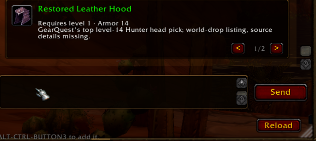
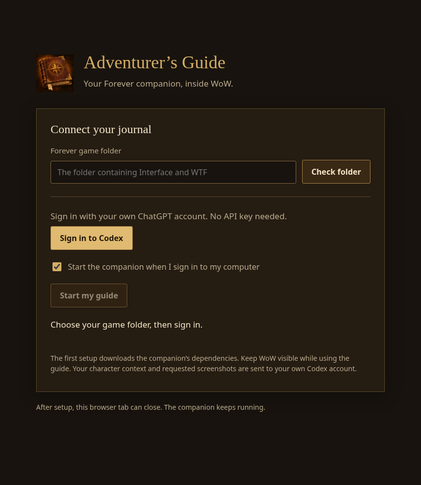

# Adventurer’s Guide

A companion for **WoW: Forever**.

- Live character data and Forever guides.
- GearQuest/Dungeon Journal comparisons with native item cards.
- Combat breakdowns, crits, pets and timed measurements.
- Auctionator prices and character memory.
- Minimap launcher, smooth scrolling, resizing and model/effort controls.

**Ctrl+Alt+middle-click** attaches items, spells and quests—including chat links and loot rolls.

## Install

1. Download the [ZIP](https://github.com/BeLikeBrett/Adventurers-Guide/releases/latest); copy **WoWAI** into `Interface/AddOns`.
2. Run **Start Guide.cmd** (Windows) or **Start Guide.sh** (Linux).
3. Click **Sign in to Codex**, start the guide, then reopen WoW.

Windows beta; Linux Niri/X11. Companion autostart available. Codex limits apply. Prices need scans; restricted data stays unknown. No gameplay automation.

MIT, based on [wow-ai](https://github.com/chelinho139/wow-ai). Other addons remain separate.
